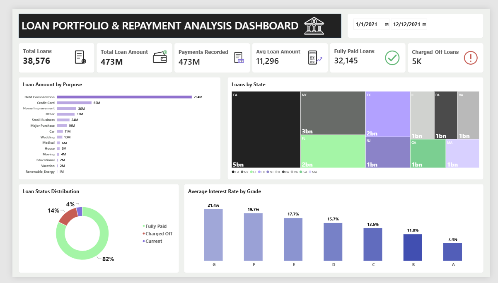
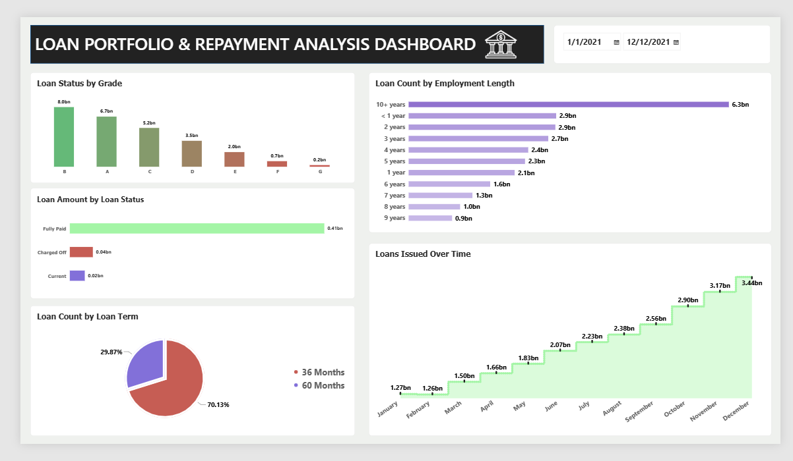

# Loan-Portfolio-Dashboard
Power BI dashboard analyzing loan portfolio performance, repayment status, interest rates by grade, loan purpose, state distribution, and loan issuance trends across 2021

# 🏦 Loan Portfolio & Repayment Analysis Dashboard

## 📌 Project Overview

This Power BI dashboard analyzes a loan portfolio to show how loans are distributed, how borrowers repay, and how risk varies across loan grades. It covers loans from **1 Jan 2021 to 12 Dec 2021**. It helps lenders understand portfolio size, repayment performance, and the factors linked to charged-off loans.

## 📊 Dashboard Features

- 📅 Date range filter for time-based analysis
- 🎯 Loan amount by purpose
- 🗺️ Loan distribution by state
- ✅ Loan status distribution (Fully Paid, Charged Off, Current)
- 📉 Average interest rate by loan grade
- 🏅 Loan status by grade
- 💰 Loan amount by loan status
- ⏳ Loan count by loan term (36 vs 60 months)
- 👔 Loan count by employment length
- 📈 Loans issued over time (monthly trend)

## 📈 Key KPIs

| KPI | Value |
|-----|-------|
| Total Loans | 38,576 |
| Total Loan Amount | 473M |
| Payments Recorded | 473M |
| Average Loan Amount | 11,296 |
| Fully Paid Loans | 32,145 |
| Charged-Off Loans | 5K |

## 🛠️ Tools & Technologies

- **Power BI** – data visualization and dashboard design

## 🖼️ Screenshot

### Page 1 – Portfolio Overview

### Page 2 – Loan Status & Trends

## 💡 Business Insights

- 💳 **Debt Consolidation** is the largest loan purpose at 254M, more than half of the total loan amount.
- 🗺️ **California** has the highest loan volume by state, followed by New York, Florida, and Texas.
- ✅ **82%** of loans are Fully Paid, **14%** are Charged Off, and **4%** are Current.
- 📉 Average interest rate rises as grade gets lower, from **7.4% (Grade A)** to **21.4% (Grade G)**.
- 🏅 Grades **B, A, and C** make up the largest share of loans, while Grades F and G are the smallest.
- ⏳ About **70%** of loans have a **36-month** term, and about **30%** have a 60-month term.
- 👔 Borrowers with **10+ years** of employment have the highest loan count.
- 📈 Loan issuance rises through 2021, with **December** the highest month.

## 👨‍💻 Author

**Subhakar**
Aspiring Data Analyst | Power BI
